<div align="center">

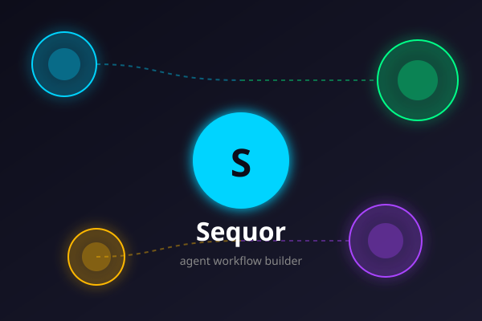

# ⚡ Sequor

**Reliable agent automations, built from small focused agents instead of one giant prompt.**

[](LICENSE)
[](https://nodejs.org/)
[](http://makeapullrequest.com)
[](https://github.com/Abdulhadi446/Sequor)

[🚀 Quick Start](#-quick-start) · [📖 Documentation](#-documentation) · [🐛 Report Bug](https://github.com/Abdulhadi446/Sequor/issues) · [✨ Request Feature](https://github.com/Abdulhadi446/Sequor/issues)

</div>

---

## 📸 Screenshots & Media

<div align="center">

| Canvas Editor | Run View |
|:---:|:---:|
|  |  |

| Workflow List | Node Inspector |
|:---:|:---:|
|  |  |

| Hero / Brand |
|:---:|
|  |

| Demo Video |
|:---:|
| <video src="./docs/demo.mp4" controls width="600"></video> |

</div>

> 🎥 **Demo Video:** Now available (docs/demo.mp4)

---

## 📋 Table of Contents

- [What is Sequor?](#-what-is-sequor)
- [The Problem](#-the-problem)
- [The Solution](#-the-solution)
- [Architecture](#-architecture)
- [Features](#-features)
- [Quick Start](#-quick-start)
- [Demo Video](#-demo-video)
- [Installation](#-installation)
- [Usage](#-usage)
- [Workflow Templates](#-workflow-templates)
- [API Reference](#-api-reference)
- [Ecosystem Integration](#-ecosystem-integration)
- [Roadmap](#-roadmap)
- [Contributing](#-contributing)
- [License](#-license)
- [Contact](#-contact)

---

## 🎯 What is Sequor?

**Sequor** is an n8n-style visual builder where every node is a real coding agent with its own prompt, tools, and workspace. It stops automations from drifting, timing out, and silently skipping steps.

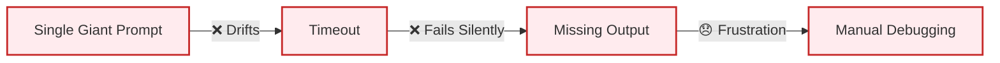

> 💡 **The insight:** Small, focused agents with structured handoffs are more reliable than one massive prompt.

---

## 🔥 The Problem

I run Hermes agent with **4 cron jobs**. It sometimes doesn't do everything. One huge prompt in a cron job tries to research, write, check, and publish in a single run, and somewhere in the middle it drifts, forgets a step, or times out. Nobody finds out until the output is missing.

**This is not just my setup.** Anyone running scheduled agent pipelines (blogs, social video, outreach) hits the same wall:

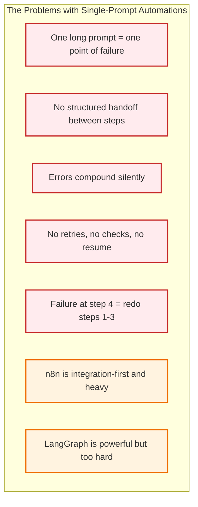

### 📊 Visualizing the Problem

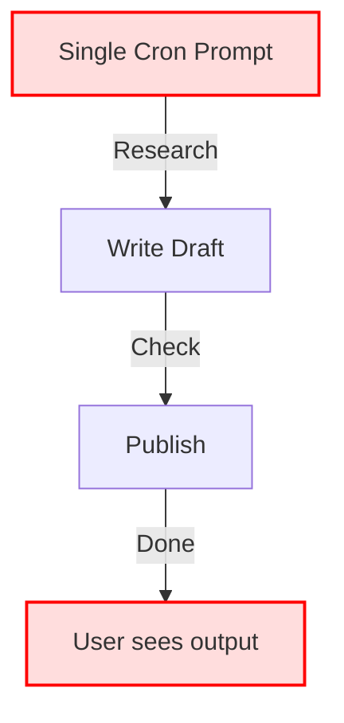

---

## ✨ The Solution

Small, focused agent nodes chained on a canvas:

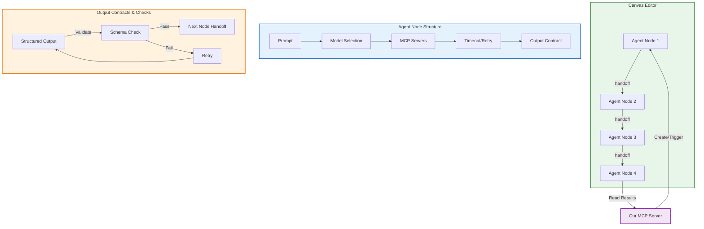

### 🔧 Solution Architecture

| Component | Description |
|-----------|-------------|
| **Agent Nodes** | Each has a focused prompt, model choice, attached MCP servers, timeout and retry policy |
| **Output Contracts** | Every node returns validated structured output. If validation fails, it retries with the error fed back |
| **Structured Handoff** | The next node gets the previous node's fields, never the raw transcript |
| **Check Nodes** | Verify the previous output and route to pass, retry, or fail |
| **Resume from Failure** | Restart from the failed node without redoing earlier work |
| **Live Run View** | Per-node status, logs, outputs, duration, and cost |
| **Triggers** | Manual, cron with timezone, and webhook |
| **Our Own MCP Server** | Other agents can create workflows, trigger runs, and read results. Agents that automate agents |

---

## 🏗️ Architecture

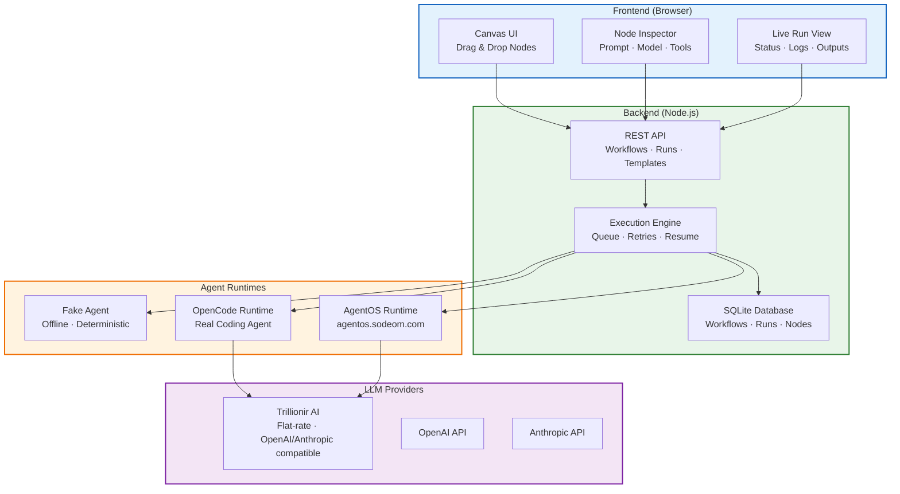

---

## 🎨 Features

- ✅ **Visual Canvas Editor** — Drag, drop, and connect nodes
- ✅ **Agent-per-Node Architecture** — Each node is a real coding agent
- ✅ **Output Contracts** — Validated structured output with automatic retries
- ✅ **Check Nodes** — Route to pass, retry, or fail
- ✅ **Resume from Failure** — Restart from failed node without redoing earlier work
- ✅ **Live Run View** — Real-time per-node status, logs, outputs, duration, cost
- ✅ **Multiple Triggers** — Manual, cron with timezone, webhook
- ✅ **MCP Server Support** — Attach MCP servers per node
- ✅ **Starter Templates** — Daily blog, social video, cold outreach, webhook relay, fetch → code → brief
- ✅ **Account Authentication** — Sign up, sign in, session cookies, per-user data isolation
- ✅ **Encrypted Credentials** — Store provider API keys server-side, pick per node
- ✅ **Knowledge Bases** — Local hashed or remote embeddings, searchable by agents
- ✅ **Agent Registry** — Import opencode.json with AGENTS.md, skills, MCP servers, tool permissions
- ✅ **HTTP & Fetch Nodes** — Real API calls, shaped with JavaScript code nodes
- ✅ **Scheduler** — Active workflows fire on schedule even when the editor is closed
- ✅ **Self-Hosted** — Run on your own infrastructure
- ✅ **Model-Agnostic** — Works with OpenAI, Anthropic, or any OpenAI-compatible API
- ✅ **Bring Your Own Key** — Use your preferred LLM provider

---

## 🚀 Quick Start

Get Sequor running in **under 2 minutes**:

```bash
# Clone the repository
git clone https://github.com/Abdulhadi446/Sequor.git
cd Sequor

# Install dependencies (none required!)
# Sequor uses Node.js built-in modules only

# Start the server
npm start

# Open your browser
open http://127.0.0.1:3000
```

> 🎉 **That's it!** On first launch you create an account, then a starter workflow is pre-loaded for you.

### 🐳 Docker (Optional)

```bash
# Build the image
docker build -t sequor .

# Run the container
docker run -p 3000:3000 sequor
```

---

## 📦 Installation

### Prerequisites

- **Node.js** >= 22.5
- **npm** (comes with Node.js)
- **Git**

### Step-by-Step Installation

1. **Clone the repository:**
   ```bash
   git clone https://github.com/Abdulhadi446/Sequor.git
   cd Sequor
   ```

2. **Verify Node.js version:**
   ```bash
   node --version  # Should be >= 22.5
   ```

3. **Start the development server:**
   ```bash
   npm start
   # or for auto-reload during development:
   npm run dev
   ```

4. **Open your browser:**
   Navigate to `http://127.0.0.1:3000`

5. **(Optional) Run tests:**
   ```bash
   npm run check
   ```

---

## 💻 Usage

### Creating Your First Workflow

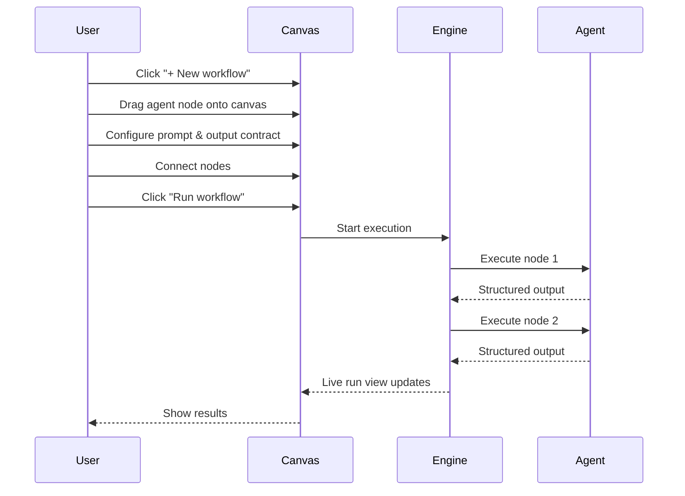

### Node Types

| Node Type | Purpose | Example |
|-----------|---------|---------|
| **Trigger** | Start a workflow | Manual, cron, webhook |
| **Agent** | Execute a focused task | Research, write, analyze |
| **Check** | Validate output | Schema validation, business logic |

### Example: Daily Blog Workflow

```mermaid
graph TD
    subgraph Workflow["Daily Blog Workflow"]
        N1["<b>Node 1: Ideation</b>"]
        N2["<b>Node 2: Research</b>"]
        N3["<b>Node 3: Outlining</b>"]
        N4["<b>Node 4: Writing</b>"]
        N5["<b>Node 5: Editing</b>"]
        N6["<b>Node 6: Formatting</b>"]
        N7["<b>Node 7: Publishing</b>"]
        End(["<b>End: Published URL</b>"])
        
        N1 -->|handoff: topic + angle| N2
        N2 -->|handoff: sources + context| N3
        N3 -->|handoff: structure + keypoints| N4
        N4 -->|handoff: draft text| N5
        N5 -->|handoff: polished draft| N6
        N6 -->|handoff: markdown + seo| N7
        N7 -->|output: live URL| End
    end
    
    classDef contract fill:#e8f5e9,stroke:#2e7d32,stroke-width:1.5px,color:#1b5e20
    class N1,N2,N3,N4,N5,N6,N7 contract
    style End fill:#e3f2fd,stroke:#1565c0,stroke-width:2px
```

#### Node Details for Daily Blog Workflow

| Node | Prompt Focus | Output Contract | Retries |
|------|-------------|-----------------|---------|
| **1. Ideation** | Generate 3 blog topics based on trending keywords | `{topic: string, angle: string, audience: string}` | 2 |
| **2. Research** | Search and summarize 5 authoritative sources | `{sources: array, key_points: array, summary: string}` | 2 |
| **3. Outlining** | Create structured outline with hooks | `{outline: string, h2s: array, h3s: array}` | 1 |
| **4. Writing** | Write full draft following outline | `{draft: string, word_count: number}` | 1 |
| **5. Editing** | Check flow, clarity, brand voice consistency | `{polished: string, edits_made: number}` | 1 |
| **6. Formatting** | Convert to markdown, add SEO elements, meta description | `{markdown: string, meta: object, seo_score: number}` | 1 |
| **7. Publishing** | Publish to CMS, verify live URL | `{url: string, status: "success"|"failed"}`, `published_at: datetime` | 0 |

### Example: Cold Outreach Sequence

```mermaid
graph TD
    subgraph Outreach["Cold Outreach Sequence"]
        N1["<b>Node 1: Identify Leads</b>"]
        N2["<b>Node 2: Enrich Data</b>"]
        N3["<b>Node 3: Personalize</b>"]
        N4["<b>Node 4: Draft Email</b>"]
        N5["<b>Node 5: Review</b>"]
        N6["<b>Node 6: Send Email</b>"]
        N7["<b>Node 7: Track Results</b>"]
        End(["<b>End: Results Analyzed</b>"])
        
        N1 -->|handoff: company + role| N2
        N2 -->|handoff: tech_stack + funding| N3
        N3 -->|handoff: custom_opener + value_prop| N4
        N4 -->|handoff: email_copy + subject| N5
        N5 -->|handoff: approved + changes| N6
        N6 -->|handoff: message_id + sent_at| N7
        N7 -->|output: open + reply rates| End
    end
    
    classDef step fill:#e8f5e9,stroke:#2e7d32,stroke-width:1.5px
    class N1,N2,N3,N4,N5,N6,N7 step
    style End fill:#e3f2fd,stroke:#1565c0,stroke-width:2px
```

### Example: Social Video Repurposing

```mermaid
graph TD
    subgraph Video["Social Video Pipeline"]
        N1["<b>Node 1: Source Input</b>"]
        N2["<b>Node 2: Transcribe</b>"]
        N3["<b>Node 3: Analyze Hooks</b>"]
        N4["<b>Node 4: Write Script</b>"]
        N5["<b>Node 5: Generate Clips</b>"]
        N6["<b>Node 6: Publish Clips</b>"]
        End(["<b>End: Live on Platforms</b>"])
        
        N1 -->|handoff: video_url + topic| N2
        N2 -->|handoff: transcript + timestamps| N3
        N3 -->|handoff: best_moments + viral_hooks| N4
        N4 -->|handoff: scripts + timecodes| N5
        N5 -->|handoff: clips + captions| N6
        N6 -->|output: platform URLs + engagement| End
    end
    
    classDef step fill:#e8f5e9,stroke:#2e7d32,stroke-width:1.5px
    class N1,N2,N3,N4,N5,N6,N7 step
    style End fill:#e3f2fd,stroke:#1565c0,stroke-width:2px
```

#### Node Details for Social Video Workflow

| Node | Prompt Focus | Output Contract | Retries |
|------|-------------|-----------------|---------|
| **1. Source Input** | Take video URL + target platforms | `{video_url: string, platforms: array, tone: string}` | 0 |
| **2. Transcribe** | Whisper-style transcription with timestamps | `{transcript: string, segments: array, duration: number}` | 1 |
| **3. Analyze Hooks** | Find viral moments and emotional beats | `{best_moments: array, hook_score: number, emotions: array}` | 1 |
| **4. Write Script** | Write platform-native scripts with hooks | `{scripts: object, hashtags: array, ctas: string}` | 1 |
| **5. Generate Clips** | FFmpeg/clip generation with captions | `{clips: array, captions: object, thumbnails: array}` | 1 |
| **6. Publish Clips** | Upload to TikTok/Reels/Shorts, schedule | `{platform_urls: object, scheduled_at: datetime}` | 0 |

---

## 📚 Documentation

### API Reference

| Endpoint | Method | Description |
|----------|--------|-------------|
| `/api/state` | GET | Get workflows, templates, runtime info |
| `/api/workflows` | GET | List all workflows |
| `/api/workflows` | POST | Create a new workflow |
| `/api/workflows/:id` | GET | Get a specific workflow |
| `/api/workflows/:id` | PUT | Update a workflow |
| `/api/workflows/:id` | DELETE | Delete a workflow |
| `/api/workflows/:id/run` | POST | Execute a workflow |
| `/api/workflows/:id/hook` | POST | Trigger via webhook |
| `/api/runs` | GET | List recent runs |
| `/api/runs/:id` | GET | Get run details |
| `/api/runs/:id/events` | GET | SSE stream for live updates |
| `/api/runs/:id/cancel` | POST | Cancel a running workflow |
| `/api/runs/:id/resume` | POST | Resume from failure |
| `/api/templates` | GET | List starter templates |
| `/api/templates/:key` | POST | Create workflow from template |

### Environment Variables

| Variable | Default | Description |
|----------|---------|-------------|
| `PORT` | `3000` | Server port |
| `HOST` | `127.0.0.1` | Server host |
| `OPENAI_API_KEY` | — | OpenAI API key (optional) |
| `OPENAI_MODEL` | `gpt-4o-mini` | Model to use |
| `ANTHROPIC_API_KEY` | — | Anthropic API key (optional) |

---

## 🌐 Ecosystem Integration

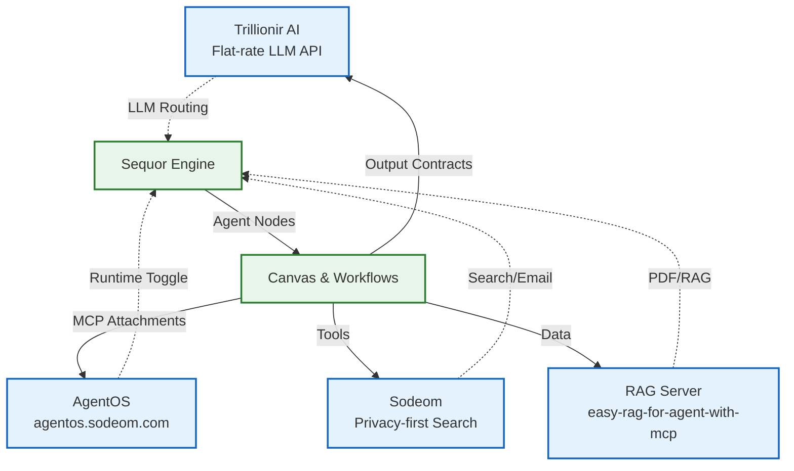

### Why This Ecosystem Matters

Most teams would need to build or buy every layer. I already own them:

| Service | Description | Role in Sequor |
|---------|-------------|----------------|
| **Trillionir AI** | Flat-rate LLM inference API with OpenAI and Anthropic-compatible routing | Default model provider |
| **AgentOS** | My own agent runtime (agentos.sodeom.com) | Per-node runtime toggle |
| **Sodeom** | Privacy-first search engine | Built-in search and email tools |
| **easy-rag-for-agent-with-mcp** | RAG server exposed over MCP | RAG and PDF conversion out of the box |

The product ships **batteries-included** on day one, and everything stays swappable. Bring your own key, your own MCP servers, your own runtime.

---

## 🎯 Who Is It For?

| Segment | Share |
|---------|-------|
| Solo devs and indie hackers running agent cron pipelines | 30% |
| Content and social automation operators | 20% |
| Technical founders automating internal ops | 15% |
| Freelancers and agencies selling automations | 12% |
| n8n and Zapier power users hitting limits | 10% |
| Small dev teams building internal tooling | 8% |
| Truly non-technical users | 5% |

> **About 85% are technical or semi-technical**, so the pitch is reliability for builders, not no-code for everyone.

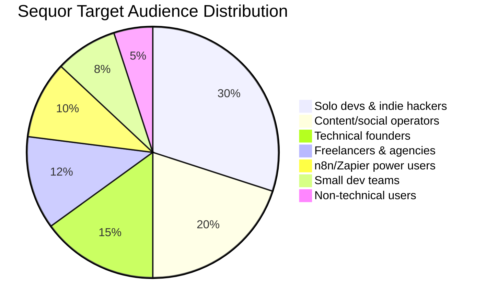

---

## 📊 Comparison

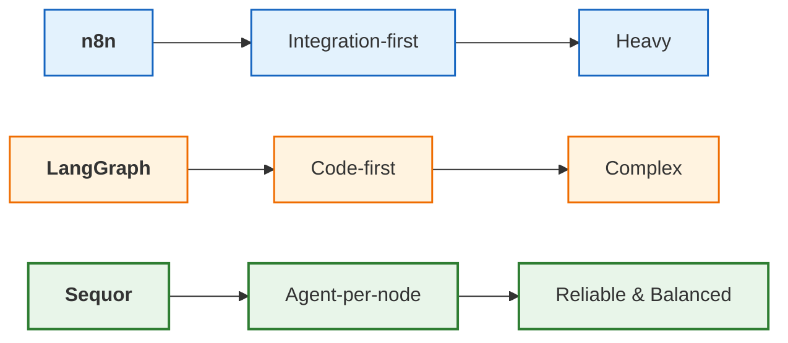

| Feature | n8n | LangGraph | **Sequor** |
|---------|-----|-----------|------------|
| Visual Builder | ✅ | ❌ | ✅ |
| Agent-per-Node | ❌ | ✅ | ✅ |
| Output Contracts | ❌ | ⚠️ | ✅ |
| Check Nodes | ⚠️ | ✅ | ✅ |
| Resume from Failure | ❌ | ⚠️ | ✅ |
| Self-Hosted | ✅ | ✅ | ✅ |
| MCP Support | ⚠️ | ✅ | ✅ |
| Starter Templates | ⚠️ | ❌ | ✅ |

---

## 🗺️ Roadmap

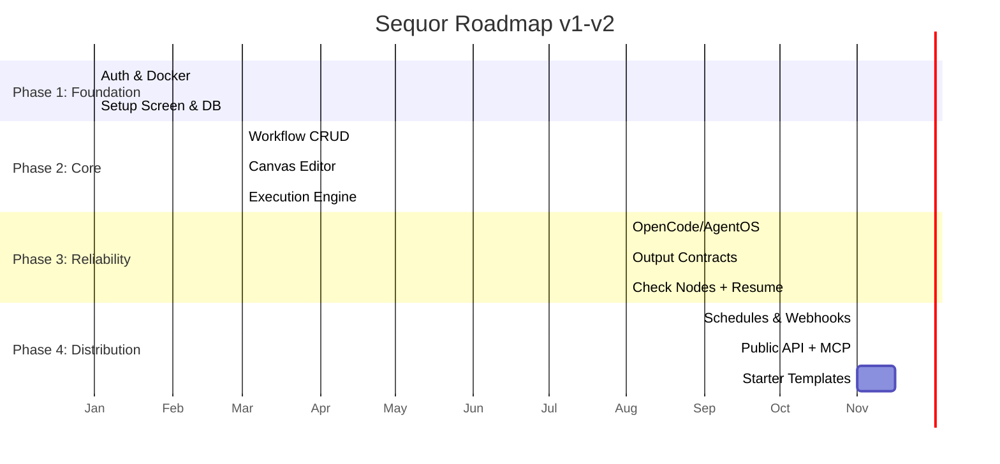

### Milestones

| Phase | Timeline | Key Deliverables |
|-------|----------|------------------|
| **Phase 1: Foundation** | Q1 2026 | Auth, setup screen, database, Docker packaging |
| **Phase 2: Core** | Q1-Q2 2026 | Workflow CRUD, canvas editor, execution engine |
| **Phase 3: Reliability** | Q3 2026 | Real runtimes, output contracts, check nodes, resume |
| **Phase 4: Distribution** | Q4 2026 | Schedules, webhooks, public API, MCP server, templates |

**First proof point:** The daily blog template running reliably end to end, compared against my current cron setup.

---

## 🤝 Contributing

Contributions are welcome! Please feel free to submit a Pull Request.

1. Fork the repository
2. Create your feature branch (`git checkout -b feature/AmazingFeature`)
3. Commit your changes (`git commit -m 'Add some AmazingFeature'`)
4. Push to the branch (`git push origin feature/AmazingFeature`)
5. Open a Pull Request

---

## 📄 License

This project is licensed under the MIT License - see the [LICENSE](LICENSE) file for details.

---

## 📬 Contact

**Abdulhadi** — Founder, Trillionir AI & Sodeom

- 🌐 Website: [thetrillioniar.me](https://thetrillioniar.me)
- 🐙 GitHub: [github.com/Abdulhadi446](https://github.com/Abdulhadi446)
- 📍 Location: Karachi, Pakistan

---

<div align="center">

**⭐ Star this repo if you find it useful!**

Made with ❤️ by [Abdulhadi](https://github.com/Abdulhadi446)

</div>