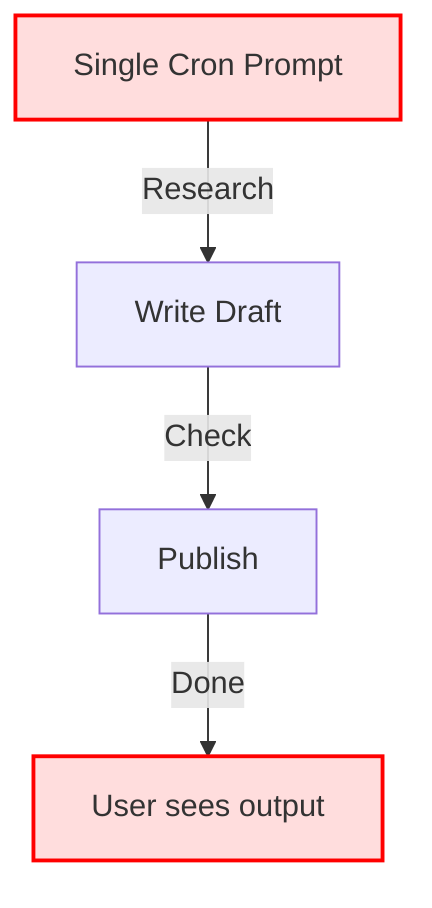
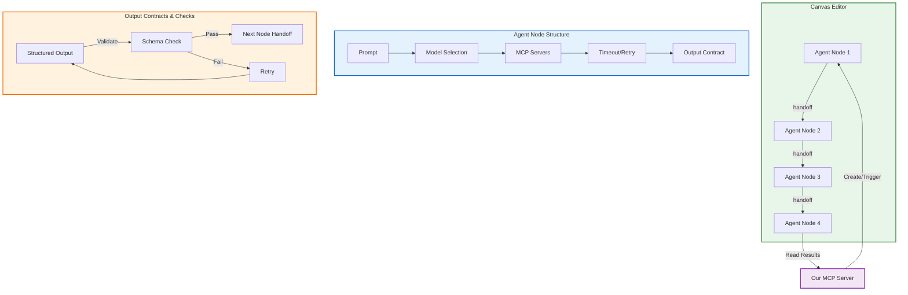
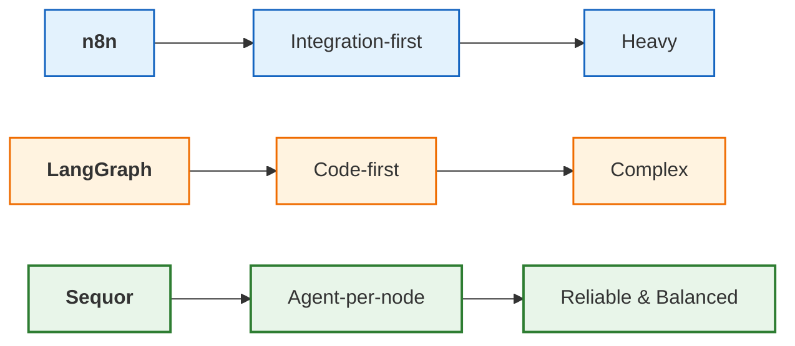
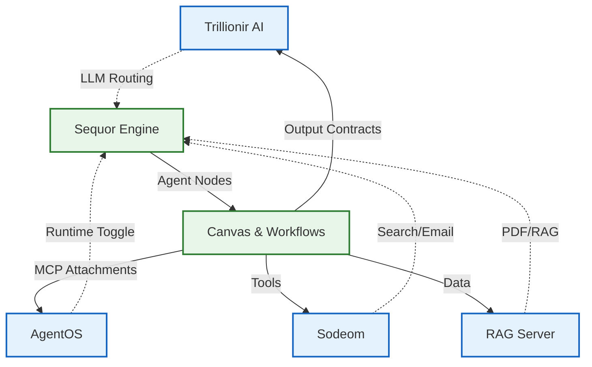
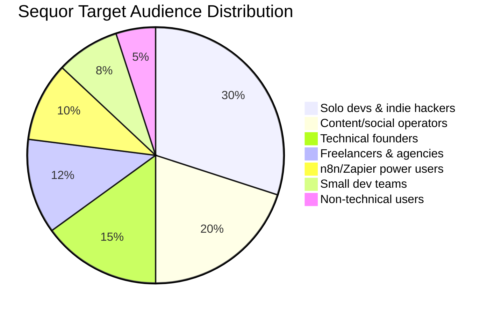
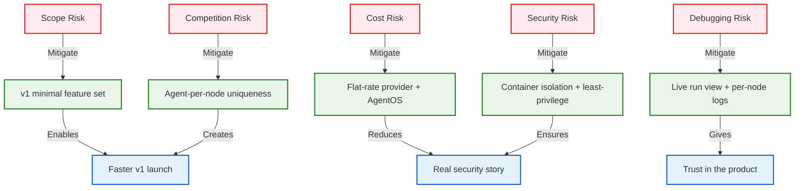
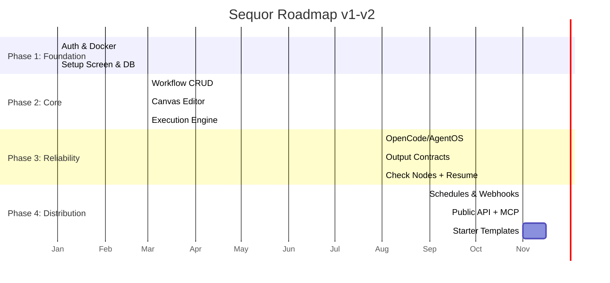

# Agent Workflow Builder

*Reliable agent automations, built from small focused agents instead of one giant prompt. Working title. Pitch by Abdulhadi, founder of Trillionir AI and Sodeom.*

## The one-line pitch

An n8n-style visual builder where every node is a real coding agent with its own prompt, tools and workspace, so automations stop drifting, timing out and silently skipping steps.

## The problem (I have it myself)

I run Hermes agent with 4 cron jobs. It sometimes doesn't do everything. One huge prompt in a cron job tries to research, write, check and publish in a single run, and somewhere in the middle it drifts, forgets a step or times out. Nobody finds out until the output is missing.

This is not just my setup. Anyone running scheduled agent pipelines (blogs, social video, outreach) hits the same wall:

- One long prompt means one point of failure and no visibility into where it broke.
- No structured handoff between steps, so errors compound.
- No retries, no checks, no resume. A failure at step 4 means redoing steps 1 to 3.
- Tools like n8n are integration-first and heavy. LangGraph is powerful but too hard for most people.

> 💡 **Visualizing the problem:**

## The solution

Small, focused agent nodes chained on a canvas:

- **Agent nodes:** each has a focused prompt, model choice, attached MCP servers, timeout and retry policy.
- **Output contracts:** every node returns validated structured output. If validation fails, it retries with the error fed back.
- **Structured handoff:** the next node gets the previous node's fields, never the raw transcript.
- **Check nodes:** verify the previous output and route to pass, retry or fail.
- **Resume from failure:** restart from the failed node without redoing earlier work.
- **Live run view:** per-node status, logs, outputs, duration and cost.
- **Triggers:** manual, cron with timezone, and webhook.
- **Our own MCP server:** other agents can create workflows, trigger runs and read results. Agents that automate agents.

> 🔧 **Visualizing the solution architecture:**

## Example workflow: Daily Blog Template

Here's a concrete end-to-end workflow that demonstrates the power of agent-per-node architecture:

> 📝 **Daily Blog Workflow:**

```mermaid
graph TD
    subgraph Workflow["Daily Blog Workflow"]
        N1["<b>Node 1: Ideation</b>"]
        N2["<b>Node 2: Research</b>"]
        N3["<b>Node 3: Outlining</b>"]
        N4["<b>Node 4: Writing</b>"]
        N5["<b>Node 5: Editing</b>"]
        N6["<b>Node 6: Formatting</b>"]
        N7["<b>Node 7: Publishing</b>"]
        End(["<b>End: Published URL</b>"])

        N1 -->|handoff: topic + angle| N2
        N2 -->|handoff: sources + context| N3
        N3 -->|handoff: structure + keypoints| N4
        N4 -->|handoff: draft text| N5
        N5 -->|handoff: polished draft| N6
        N6 -->|handoff: markdown + seo| N7
        N7 -->|output: live URL| End
    end

    classDef contract fill:#e8f5e9,stroke:#2e7d32,stroke-width:1.5px,color:#1b5e20
    class N1,N2,N3,N4,N5,N6,N7 contract
    style End fill:#e3f2fd,stroke:#1565c0,stroke-width:2px
```

### Node Details for Daily Blog Workflow

| Node | Prompt Focus | Output Contract | Retries |
|------|-------------|-----------------|---------|
| **1. Ideation** | Generate 3 blog topics based on trending keywords | `{topic: string, angle: string, audience: string}` | 2 |
| **2. Research** | Search and summarize 5 authoritative sources | `{sources: array, key_points: array, summary: string}` | 2 |
| **3. Outlining** | Create structured outline with hooks | `{outline: string, h2s: array, h3s: array}` | 1 |
| **4. Writing** | Write full draft following outline | `{draft: string, word_count: number}` | 1 |
| **5. Editing** | Check flow, clarity, brand voice consistency | `{polished: string, edits_made: number}` | 1 |
| **6. Formatting** | Convert to markdown, add SEO elements, meta description | `{markdown: string, meta: object, seo_score: number}` | 1 |
| **7. Publishing** | Publish to CMS, verify live URL | `{url: string, status: "success"|"failed"}`, `published_at: datetime` | 0 |

## Example workflow: Cold Outreach Sequence

> 💼 **Cold Outreach Workflow:**

```mermaid
graph TD
    subgraph Outreach["Cold Outreach Sequence"]
        N1["<b>Node 1: Identify Leads</b>"]
        N2["<b>Node 2: Enrich Data</b>"]
        N3["<b>Node 3: Personalize</b>"]
        N4["<b>Node 4: Draft Email</b>"]
        N5["<b>Node 5: Review</b>"]
        N6["<b>Node 6: Send Email</b>"]
        N7["<b>Node 7: Track Results</b>"]
        End(["<b>End: Results Analyzed</b>"])

        N1 -->|handoff: company + role| N2
        N2 -->|handoff: tech_stack + funding| N3
        N3 -->|handoff: custom_opener + value_prop| N4
        N4 -->|handoff: email_copy + subject| N5
        N5 -->|handoff: approved + changes| N6
        N6 -->|handoff: message_id + sent_at| N7
        N7 -->|output: open + reply rates| End
    end

    classDef step fill:#e8f5e9,stroke:#2e7d32,stroke-width:1.5px
    class N1,N2,N3,N4,N5,N6,N7 step
    style End fill:#e3f2fd,stroke:#1565c0,stroke-width:2px
```

## Example workflow: Social Video Repurposing

> 🎬 **Social Video Workflow:**

```mermaid
graph TD
    subgraph Video["Social Video Pipeline"]
        N1["<b>Node 1: Source Input</b>"]
        N2["<b>Node 2: Transcribe</b>"]
        N3["<b>Node 3: Analyze Hooks</b>"]
        N4["<b>Node 4: Write Script</b>"]
        N5["<b>Node 5: Generate Clips</b>"]
        N6["<b>Node 6: Publish Clips</b>"]
        End(["<b>End: Live on Platforms</b>"])

        N1 -->|handoff: video_url + topic| N2
        N2 -->|handoff: transcript + timestamps| N3
        N3 -->|handoff: best_moments + viral_hooks| N4
        N4 -->|handoff: scripts + timecodes| N5
        N5 -->|handoff: clips + captions| N6
        N6 -->|output: platform URLs + engagement| End
    end

    classDef step fill:#e8f5e9,stroke:#2e7d32,stroke-width:1.5px
    class N1,N2,N3,N4,N5,N6,N7 step
    style End fill:#e3f2fd,stroke:#1565c0,stroke-width:2px
```

### Node Details for Social Video Workflow

| Node | Prompt Focus | Output Contract | Retries |
|------|-------------|-----------------|---------|
| **1. Source Input** | Take video URL + target platforms | `{video_url: string, platforms: array, tone: string}` | 0 |
| **2. Transcribe** | Whisper-style transcription with timestamps | `{transcript: string, segments: array, duration: number}` | 1 |
| **3. Analyze Hooks** | Find viral moments and emotional beats | `{best_moments: array, hook_score: number, emotions: array}` | 1 |
| **4. Write Script** | Write platform-native scripts with hooks | `{scripts: object, hashtags: array, ctas: string}` | 1 |
| **5. Generate Clips** | FFmpeg/clip generation with captions | `{clips: array, captions: object, thumbnails: array}` | 1 |
| **6. Publish Clips** | Upload to TikTok/Reels/Shorts, schedule | `{platform_urls: object, scheduled_at: datetime}` | 0 |

## Why this is a good idea

1. The pain is real and common: giant cron prompts fail.
2. No integrations to maintain. Capabilities come from MCP servers, skills and plugins.
3. Structured handoffs and output contracts are a principled reliability pattern.
4. Resume from the failed node saves time and money.
5. Least-privilege tools per node give a real security story.
6. Exposing our own MCP server is timely and a headline feature.
7. Self-hosted, bring-your-own-key and model-agnostic appeals to privacy-minded builders.
8. Clear gap in the market between n8n (integrations-first) and LangGraph (code-first).
9. Concrete starter templates people already pay for: daily blog, social video, cold outreach.
10. A clear build plan that proves the engine with a fake agent before touching a real runtime.

> 📊 **Visual comparison of approaches:**

## Why me: backed by my own ecosystem

Most teams would need to build or buy every layer. I already own them:

- **Trillionir AI:** my flat-rate LLM inference API with OpenAI and Anthropic-compatible routing, as the default model provider.
- **AgentOS:** my own agent runtime (agentos.sodeom.com), which I can change freely. Nodes can run on either OpenCode or AgentOS with a per-node toggle, so we are never stuck on one runtime.
- **Sodeom:** my privacy-first search engine, for built-in search and email tools.
- **easy-rag-for-agent-with-mcp:** my RAG server exposed over MCP, covering RAG and PDF conversion out of the box.

The product ships batteries-included on day one, and everything stays swappable. Bring your own key, your own MCP servers, your own runtime.

> 🎯 **Ecosystem integration diagram:**

## Who it is for (rough estimates)

| Segment | Share |
| --- | --- |
| Solo devs and indie hackers running agent cron pipelines | 30% |
| Content and social automation operators | 20% |
| Technical founders automating internal ops | 15% |
| Freelancers and agencies selling automations | 12% |
| n8n and Zapier power users hitting limits | 10% |
| Small dev teams building internal tooling | 8% |
| Truly non-technical users | 5% |

About 85% are technical or semi-technical, so the pitch is reliability for builders, not no-code for everyone.

> 👥 **Target audience visualization:**

## Honest risks and how we handle them

- **Scope is large.** v1 is cut to auth, workflows, canvas, execution engine, real runtimes, output contracts, check nodes and resume. Schedules and the MCP server come right after.
- **Competition.** n8n, Dify, Flowise and Langflow exist. Our edge is agent-per-node with contracts, checks and resume.
- **Cost and latency.** A coding agent per node costs more than one LLM call. A flat-rate default provider and a lean AgentOS option reduce that.
- **Security.** Agents with secrets need real isolation. Container isolation is on by default, with least-privilege tools per node.
- **Debugging UX.** Agent logs are huge. The run view has to make failures obvious in seconds.

> ⚠️ **Risk mitigation strategy:**

## Roadmap

1. Auth, setup screen, database and Docker packaging.
2. Workflow CRUD and canvas editor.
3. Execution engine with a fake agent to prove queue, retries and live run view.
4. Real runtimes (OpenCode and AgentOS) with MCP attachment.
5. Output contracts, check nodes and resume from failure.
6. Schedules, webhooks and notifications.
7. Public API, our MCP server and starter templates.

First proof point: the daily blog template running reliably end to end, compared against my current cron setup.

> 🏁 **Roadmap milestones visualization:**

## What I am asking you

- Honest feedback: would you use this, and what would stop you?
- Your own pain: what automations do you run that break or skip steps?
- Early testing once the first template runs.
- Interest in helping build or co-found: [role and split to discuss]

## Contact

Abdulhadi, Karachi. thetrillioniar.me | github.com/Abdulhadi446
